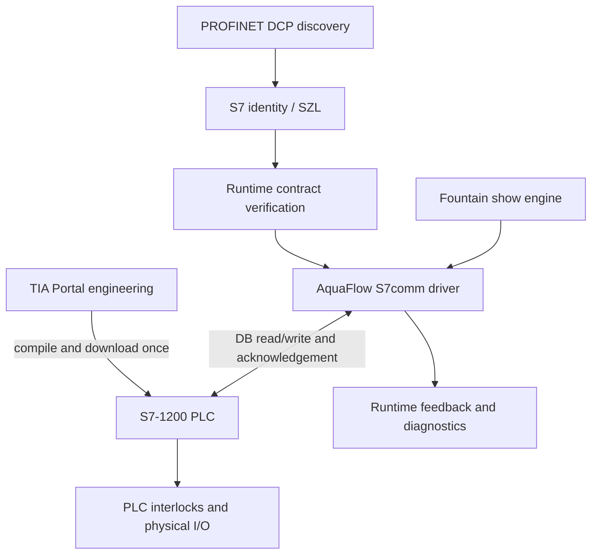

# Siemens runtime architecture

## Product boundary

TIA Portal performs hardware selection, I/O configuration, network configuration, PLC source import/review, compilation, download and physical commissioning. AquaFlow performs discovery, runtime compatibility verification, commands, feedback, show timing and connection diagnostics after TIA Portal is closed.

TIA Portal and Openness are not runtime dependencies. The PLC must already contain the matching AquaFlow DB/FB/cyclic OB and must permit the configured classic S7 data connection.

## Implemented path

1. `controller_identify.py` can scan a selected adapter/CIDR. PROFINET DCP can find devices at layer 2; a strict TCP/COTP/S7 handshake is required before a device is classified as an S7 controller.
2. `s7_identify.py` reads SZL 0x0011/0x001C where the CPU exposes them. Exact order number/firmware can be saved as expectations.
3. `siemens_runtime.py` opens ISO-on-TCP on port 102 through `s7_client.py`.
4. Verify reads the 64-byte header twice. It validates magic, contract version, header size, site signature, program version, capacities, 100 ms cycle and a moving PLC heartbeat. Verify makes no DB write.
5. Arm requires the current saved revision, AquaFlow safety permissions, site confirmation, commissioned mappings and the PLC local permit. It sends an acknowledged all-zero OFF frame.
6. Start writes complete command frames with a staging marker, payload, AquaFlow heartbeat, final flags and sequence. The PLC adopts only a stable new sequence and publishes acknowledgement plus feedback after outputs are resolved.
7. Shows or manual values are refreshed at 10 Hz. Ten PLC cycles without a new sequence force the PLC to remove Ready/Running. Recovery requires Verify, OFF/Arm and an explicit new Start.
8. Stop sends zeros and waits for matching acknowledgement/feedback sequence. A failed acknowledgement is reported as unconfirmed.

## Responsibility split

| Layer | Owns |
|---|---|
| AquaFlow | show timing, requested pump/valve/light values, operator gates, contract verification, connection supervision, command sequence, diagnostics |
| Standard PLC logic | stable-frame adoption, command watchdog, output clamping, valve timing, pump flow-path interlock, local permissives, applied feedback, fault/rejection codes |
| Drive and control cabinet | VFD ramps/trips, contactors, overloads, safe substitute outputs |
| Independent safety system | hardwired E-stop, safety relay/PLC where required, electrical isolation, motor protection, hydraulic relief |

AquaFlow's software emergency stop coordinates runtime outputs. It is not a safety-rated E-stop and does not replace the independent safety system.

## Failure behavior

| Failure | Result |
|---|---|
| Wrong DB/magic/version/signature/capacity | Verify rejects; no write occurs |
| Static PLC heartbeat | Verify rejects or running task disarms |
| Local permit removed | PLC forces outputs safe; AquaFlow task stops and disarms |
| AquaFlow safety permission removed | AquaFlow sends Stop; PLC watchdog is the fallback |
| Cable/transport loss | Command refresh stops; PLC watchdog removes Ready/Running in about one second; AquaFlow marks Stop unconfirmed |
| Missing acknowledgement | AquaFlow does not report success and sends no next nonzero frame |
| AquaFlow restart | No automatic Start. Operator must Verify and Arm |
| PLC restart | Heartbeat/session state is re-verified; no show resumes automatically |
| Reconnect | Re-verifies contract only; remains disarmed and requires explicit Arm/Start |

## Implementation status

The raw protocol and contract behavior are exercised end to end against `FakeS7Server`. That proves AquaFlow's framing and state logic against a deterministic S7comm test double. It does not prove PLCSIM or physical CPU compatibility. No test in this repository may change that classification without recording the target CPU, firmware, TIA project, network setup and observed result.

See `SIEMENS-RUNTIME-AUDIT.md` for the before-state, `SIEMENS-PLC-RUNTIME-CONTRACT.md` for the byte layout, and `SIEMENS-RUNTIME-COMMISSIONING.md` for the TIA and acceptance procedure.
