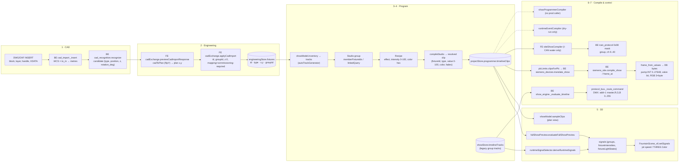

# AF-NEXT-003 — Fixture journey map and contract inventory

Date: 2026-10-13
Source revision: HEAD `a1086d0`, plus the uncommitted worktree as of this date.
Scope: read-only trace. This ticket changed no evaluator.

## How to read this note

- **Line numbers.** Paths are relative to `aquaflow/`: FE = `frontend/src`, BE = `backend`. Line numbers come from the worktree on 2026-10-13. The one exception is `BE/engine/siemens_site.py`, which is cited at **HEAD a1086d0**, because the AF-NEXT-004/005 agent is already editing it (see the note on AF-NEXT-004-01).
- **Fixtures traced.** One nozzle (`nozzle_geyser`, the CAD default for a nozzle candidate) and one RGB underwater light (`light_rgb`, the CAD default for a light candidate). In the Lebu pilot the equivalent fixtures are `lebu-center-crown` and `lebu-light-01`.

## Journey diagram

## Contract table (single writer → readers)

"Writer" means the one place that creates or sets the field. Every row with more than one writer, or with a lossy conversion, is listed again under **Inconsistencies → named tasks**.

| # | Field | Writer (single) | Reader(s) | Units / range | Conversion |
|---|---|---|---|---|---|
| 1 | CAD insert position | BE `services/cad_import.py` `_insert` :391-437 (position :430) | `cad_recognition.recognize` :575, :593-598 | CAD WCS → **metres** | `$INSUNITS` → `to_m` via `UNIT_TABLE` :54-60, `resolve_units` :846-874. Unitless drawings get a suggested unit from their extents (:855-863). Scaled by `Matrix44.scale` (:280, `_matrix` :328-330). There is no centring and no flip. |
| 2 | CAD rotation | `cad_import._insert` :418 | `cadExchange.previewCadImportResponse` :980-986 | degrees CCW, mod 360 | Plan rotation = `cadRotationToPlan` (FE `engineering/geometryContract.js` :193-197). It is −(rot + frameRot) when the Y axis is flipped. |
| 3 | Layer | `cad_import._layer` :305-309 | recognition, then `fixture.cadLayer` | string | Entities on layer 0 inside a block inherit the parent layer. |
| 4 | Plan x, y | FE `engineering/cadExchange.js` `previewCadImportResponse` :980-986 (`cadToPlan`) | `applyCadImport` :385-452 | metres, plan frame | `cadToPlan` `geometryContract.js` :175-181. Defaults: `flipY: true`, origin and rotation chosen by the user (`CAD_FRAME_DEFAULTS` :161). The client-only DXF path is `previewCadImport` :285-351 (scale, then cadToPlan, :290). |
| 5 | Fixture z (elevation) | `applyCadImport` :405-408 writes **`z: 0`** | renderer (not read, see 5c) | metres | **Lossy.** The recognised candidate `z` is dropped. |
| 6 | `fixture.id` (Engineering ID) | CAD: `cadExchange.js` :981 (matchedId, then `aquaflow_id` from XDATA, then `cad-<handle>`). Manual placement: `PoolGeometryDesigner.jsx` :1975 `Date.now()` (a **number**). Duplicate: :1419 | every downstream stage | string *or* number | **Multiple writers with mixed types.** |
| 7 | `fixture.groupId` (legacy category) | Designer: `getDefaultGroupId` :247 → `hooks/fixtureTypeMap.js` `resolveFixtureGroup` :289-342. CAD: `applyCadImport` :406 | `runtimeSignalSelector` `TYPE_ALIASES` :36-115; `FountainScene_v6` `_groupIntensityForNozzle` :2858-2910 | key (e.g. `outer_ring_jets`, `rgb_lights`) | A second resolver exists: `utils/fixtureTypeResolver.js` `getDefaultGroupId` :1502-1518, used by `runtime/autoTrackGenerator.js` :317. |
| 8 | Hardware address on a fixture | `applyCadImport` :400-408 → `engineering{plcChannel:null, icanGroup:null, icanChannel:null, mappingStatus:'commissioning-required'}` | Designer DMX fields `PoolGeometryDesigner.jsx` :3392-3393; `runtime/dmxPatch.js` `readPatch` :57+ | — | CAD never supplies addresses (good). |
| 9 | Engineering store | FE `store/engineeringStore.js` `updateEngineering` :109 / `loadProject` :120, normalised by `engineering/engineeringProject.js` `normalizeEngineeringProject` | everything | — | The publisher is debounced by 80 ms (`hooks/engineeringPublisher.js` :31). |
| 10 | Fixture tracks | `runtime/autoTrackGenerator.js` `buildFixtureTracks` :274-284 (`CATEGORY_CHANNELS` :151-196) | `showModel.inventory` :12-32, `primaryTrack` :124-128 | id `<fixtureId>-<suffix>` | Light → `lighting_master/red/green/blue`. Nozzle (category `pump`) → `pump_speed`, `pump_pressure`. |
| 11 | Studio group | `showModel.js` `autoGroups` :34-44 / user | `resolveMembers` :46-54, `orderMembers` :56-66 | `memberFixtureIds` or `linkedQuery` | Order is computed from plan x/y. |
| 12 | Recipe | `showModel.js` `newRecipe` :68-70 | `compileStudio` :149-224 | intensity 0-100; colour = sRGB hex string | — |
| 13 | Resolved clip | `compileStudio` :197-202 | `sampleClips` :226-236; `fullShowPreview` :50-99; `plcLimits.clipsForPlc` :155-160; `siteShowCompiler` | `value` 0-100 (motion −45..45 :199); `color` hex; `fadeIn`/`fadeOut` in s (0.45 × length for wave/ripple/pulse) | Phase = index/members (:188), offset :216. Colour sits **on the `lighting_master` clip**. No r/g/b clips are emitted. |
| 14 | Persisted Studio clips | `hooks/useShowDocument.js` :52-53 → `projectStore.programmer.timelineClips` | StudioPreview, PLC panel | — | They are **not** copied to `showStore.timelineTracks`. |
| 15 | Legacy group tracks | `showStore.timelineTracks` (file `timelineTracks`) | `deriveRuntimeSignals` (PreviewPanel_v5 :307); BE `show_engine` | intensity 0-100 *or* 0-1 | `normalizeIntensity` `runtimeSignalSelector.js` :123-130 treats n > 1 as a percentage. |
| 16 | 3D signals | `fullShowPreview.evaluateFullShowPreview` :50-99 (Studio preview, `StudioPreview.jsx` :32). Legacy path: `deriveRuntimeSignals` :303-548 | `FountainScene_v6.setSignals` :2915-2935 | level 0-1; colour = hex string or `{r,g,b}` 0-1 | `setSignals` merges with `Object.assign`, so stale fields survive. |
| 17 | Light colour in 3D | `sceneLighting.js` `colorFromSignalColor` :212-228 | light uniforms `FountainScene_v6.js` :2310-2318 | linear RGB | **Colour space.** A hex string goes through `new THREE.Color(hex)` (sRGB → linear, ColorManagement on). An object goes through `new THREE.Color(r,g,b)` and is treated as **already linear**. Output is `SRGBColorSpace` (:1169) with tone mapping (:1172). |
| 18 | Light intensity | `fixtureTypeMap.js` :236 (`baseIntensity = wattage/18`) | `sceneLighting.js` :181/:192 | relative | × level 0..1 |
| 19 | Jet height | `jetPhysics.js` `launchSpeed` :35-52; `FountainScene_v6._coreSpeedFor` :995-999 (unsolved) | renderer | m/s → m (h = v²/2g, :54-57) | v = exitVelocity·√demand. Intensity is clamped ≤ 1 (:431), so the over-demand branch (:41-47) never fires. The `heightScale` multiplier at :2400-2401 reads `config.engineering.heightScale`, but `fixturesToNozzleConfigs` puts it at the top level (`fixtureTypeMap.js` :244). |
| 20 | Dry-run commands | `runtimeEventCompiler.compileShow` :94-192 (only caller `utils/dryRunPreview.js` :46) | `PreviewPanel_v5.jsx` :255-304 | channel 0-1; pan/tilt deg/180 | `lighting_red/green/blue/master` → `r/g/b/intensity` (:483-497). `clip.color` is ignored (`_hexToRgb01` :774 is never called). |
| 21 | DMX bytes (programmer compiler) | `showProgrammerCompiler.compileShow` :124-243 | **no production caller** | intensity × 255 (:407); colour = raw hex bytes (`hexToDMXColor` :434-439) | `exportToDMX` :511-542 uses a fake address (`parseInt(id) % 64 * 8`). |
| 22 | Siemens command clips | BE `engine/siemens_devices.py` `translate_show` :1011-1088 → `siemens_site.compile_show` HEAD :410-465 | `frame_at` HEAD :468-484 | value 0-100 | Nozzle/valve → binary windows when value > 0 (:1040-1046). Pump capped at `max_percent` (:1047-1051). Light keeps fades only (`_base` :1091-1092). **Colour is dropped twice** (translate_show :1053-1054; compile_show HEAD :447-448). |
| 23 | Siemens DB bytes | `siemens_site.frame_from_values` HEAD :487-524 | PLC | pump INT `round(% × 27648/100)` big-endian at `PUMP_COMMAND_OFFSET + i*2`; valve bit at `VALVE_COMMAND_OFFSET + i//8`; light 3 bytes `round(c% × master% × 255/10000)` at `LIGHT_COMMAND_OFFSET + i*3` | Offsets are in `siemens_contract.py` :23-27 (64/96/112/176/272, DB_SIZE 472). Tags (`validate_site` :126-131): pump `%QW`, valve `%Qx.y`, light `%QB`×3. |
| 24 | I-CAN frame | FE `utils/siteShowCompiler.js` :9-10, :66-77 → BE `engine/ican_protocol.py` (frame :1-60, mask :127-168) | gateway UDP 2002 → 200 | channel = i*8 + b + 1 (40 ch), group uint32 big-endian; values 0/100 only, no fades | Per-channel map in `ican_mapping.py` `ChannelAssignment` :36-48. Legacy valves 1..64 go to group 1 ch + 8 or group 9 ch − 24 (`ican_site_choreography.valve_groups` :33-41). Runtime ON when ≥ 0.5 (`protocol_bus._ican_apply` :613-629). Light clips are rejected (`readWaterTimeline` :22-23). |
| 25 | DMX patch / bytes (runtime) | BE `services/dmx_assigner.py` `assign_dmx` :196-245; `protocol_bus.configure_from_fixtures` :539 (1-based → −1) | `protocol_bus._route_command` :758-826 → `protocols/artnet_driver.py` / `sacn_driver.py` | Art-Net universe 0-32767; sACN 1-63999; channel 0-indexed; bytes 0-255 | Fixed layout: addr−1 = master, then R, G, B. R/G/B are **also × intensity**, so the light is dimmed by intensity². A hex byte 0x01 is guessed as 0..1 and becomes 255 (:815-817). `int()` truncates. |
| 26 | Show time | Studio: `ShowStudio.jsx` `time` :45 (rAF :100-114). PLC follow: `followPlc` :119-123 (`status.elapsed`, polled every 400 ms, `StudioPlcPanel.jsx` :54-56). PLC: `siemens_runtime._play` :445-456 (monotonic, 10 Hz). Legacy: `showStore.playhead` :375 ← BE `show_engine._playback_loop` :348-370. I-CAN preview: `icanPreviewStore.positionAt` :6-8 (40 ms) | — | s | Five clocks; there is no single owner. |

## Inconsistencies → named tasks (Wave 1)

AF-NEXT-004 and AF-NEXT-005 are being implemented concurrently by another agent. The IDs below are sub-tasks for that work. This ticket did **not** change any evaluator.

| Task | Inconsistency | Evidence |
|---|---|---|
| **AF-NEXT-004-01** Siemens drops light colour | `translate_show` keeps only fades, id, type, start, duration and value for a light. `compile_show` (HEAD :447-448) emits no `color`. `frame_at` (HEAD :468-484) defaults to master 100 and RGB 0, so a Studio light with only a coloured `lighting_master` clip goes out **black**. Colour can only arrive through `lighting_red/green/blue` clips, which Studio never emits (row 13). *In flight:* the worktree `compile_show` now carries `color` (comment "AF-NEXT-004" at ~:450) and adds `engine/show_frame.py`. `siemens_devices.translate_show` :1053-1054 still needs the same fix. | rows 13, 22, 23 |
| **AF-NEXT-004-02** RTEC fade envelope | `runtimeEventCompiler`: the start event is STEP (≈:418), so there is no fade-in ramp. The fade-in event (EASE_IN) interpolates toward the fade-out event's value 0, so the output ramps **down across the whole hold**. Fades apply to `channels[0]` only. | :193-236, :410-470 |
| **AF-NEXT-004-03** Six evaluators, different maths | Scale: `deriveRuntimeSignals` guesses 0-1 vs 0-100, so a value of exactly 1 means 100 %. Window: `[s,e]` in `deriveRuntimeSignals` (:258) vs `[s,e)` everywhere else. Overlap: max (sampleClips ≥ tie → later), max + RGB last-wins (fullShowPreview :69-88), max + colour last-wins (deriveRuntimeSignals :443-447), latest event (RTEC), last-wins (showProgrammerCompiler :203; Siemens flattening `siemens_devices` :1107-1121), refused (Siemens compile :450-455). Loop: only fullShowPreview (:52) and BE show_engine (:355). | per-file rows 16, 20-23 |
| **AF-NEXT-004-04** Mute/solo | `sampleClips` and `fullShowPreview` ignore mute. `compileStudio` applies mute/solo to recipes only (:169) and passes legacy clips through. `deriveRuntimeSignals` honours mute but not solo (:413/419). BE `show_engine` honours solo then mute (:421-422). Siemens skips mute/disabled (:416) but not solo. | row 16 |
| **AF-NEXT-004-05** Studio clips never reach the legacy runtime | Studio writes `projectStore.programmer.timelineClips` (row 14). `deriveRuntimeSignals`, PreviewPanel_v5 and BE `show_engine` read `showStore.timelineTracks`. | rows 14-15 |
| **AF-NEXT-004-06** `showProgrammerCompiler` is dead and divergent | It has no production importer (only a doc reference in `runtime/dmxPatch.js`). It reads `clip.effects` only and ignores `value`, fades and `fixtureId`. It targets all fixtures, emits colour as undimmed hex bytes and uses fake addressing. Decide: retire it or route it through the canonical frame. | row 21 |
| **AF-NEXT-004-07** Colour-space ambiguity | `colorFromSignalColor` decodes sRGB for hex but treats `{r,g,b}` as linear, so the same colour renders differently depending on the evaluator that produced it. `fullShowPreview` :94 and `deriveRuntimeSignals` emit objects. The canonical frame should carry sRGB hex (or explicitly linear floats). | row 17 |
| **AF-NEXT-004-08** Unmastered light defaults | Siemens: master 100 with RGB 0 (black). `deriveRuntimeSignals`: white (:19-24). DMX bus: RGB default 1. `sampleClips`: `#65d9d0`. | rows 16, 22, 25 |
| **AF-NEXT-004-09** DMX intensity² and byte guessing | `protocol_bus._route_command` :792-824 multiplies RGB by intensity and also sends master. The 0x01 byte becomes 255 through the 0..1 guess (:815-817). `int()` truncates. | row 25 |
| **AF-NEXT-004-10** DMX universe off by one | The Pattern Designer UI is 1-based (`PatternDesignerPanel.jsx` :446/485). `update_dmx_map` :872-912 stores it as a 0-based Art-Net universe and also replaces registry-derived entries. The registry path subtracts 1 (:539). | row 25 |
| **AF-NEXT-004-11** Renderer drops fixture fields | Fixture z (CAD elevation is zeroed at import, row 5), `rotation` (`fixtureTypeMap` :253) and `heightScale` (:244, read from the wrong path at `FountainScene_v6` :2400) do not reach the 3D. `setNozzlesFromEngineering` :2135-2145 copies only id/type/x/z/tilt/rotationY/groupId/engineering. The light's y is hard-coded to 0 (:232). | rows 5, 19 |
| **AF-NEXT-004-12** `setSignals` merge leaves stale state | `Object.assign` keeps `fixtureLightStates` or `fixtureIntensities` from a previous signal source after a switch of evaluator. | row 16 |
| **AF-NEXT-005-01** Five clocks | Studio rAF, PLC follow (400 ms poll), Siemens runtime (10 Hz monotonic), legacy `show_engine`, I-CAN preview (40 ms). Define simulation-time vs PLC-follow ownership. | row 26 |
| **AF-NEXT-010-xx** (CAD agent) ID/group resolvers | Manual placement mints numeric `Date.now()` ids, which can collide within one ms. Two `groupId` resolvers disagree (`fixtureTypeMap.resolveFixtureGroup` vs `fixtureTypeResolver.getDefaultGroupId`). | rows 6-7 |

A seventh evaluator also exists: BE `engine/show_engine.py` `_evaluate_timeline` :407-468. It has no fades, emits one command per overlapping clip (so the bus ends up last-wins) and passes `clip.color` through. It should be included in AF-NEXT-004's golden-frame parity tests.

## Files Wave 1 should treat as the contract boundary

- **Evaluators:**
  - FE `components/programmer/studio/showModel.js`
  - FE `utils/fullShowPreview.js`
  - FE `utils/runtimeSignalSelector.js`
  - FE `utils/runtimeEventCompiler.js`
  - FE `utils/showProgrammerCompiler.js`
  - BE `engine/siemens_site.py`
  - BE `engine/siemens_devices.py`
  - BE `engine/show_engine.py`
  - BE `engine/show_frame.py` (new, in flight)
- **Consumers:**
  - FE `components/preview/FountainScene_v6.js` (`setSignals`)
  - FE `components/preview/sceneLighting.js`
  - FE `components/programmer/studio/StudioPreview.jsx`
  - FE `components/preview/PreviewPanel_v5.jsx`
  - FE `utils/dryRunPreview.js`
  - FE `video/bakeSignalSampler.js`
  - BE `engine/protocol_bus.py`
- **Persistence (AF-NEXT-006):**
  - FE `utils/showFile.js`
  - FE `hooks/useAutoSave.js`
  - FE `store/projectStore.js`
  - desktop `main.js`
